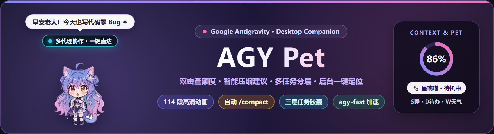
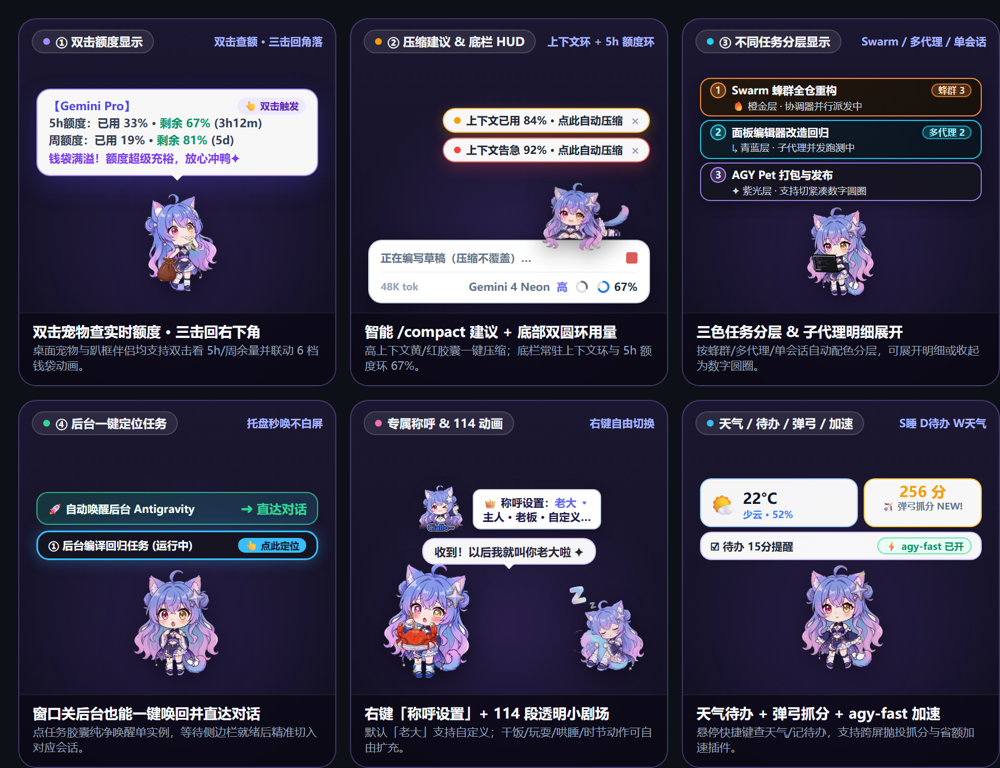

<div align="center">



# 🐾✨ AGY Pet (`agy-pet`)

**Transparent Desktop Pet, Composer Dock Companion, Layered Task Capsules, Live Dual-Ring Bottom HUD, Studio UI & `agy-fast` Suite for Google Antigravity**

Powered by Antigravity's built-in **Chrome DevTools Protocol (CDP)** for non-destructive runtime injection — **zero modifications to original installation files**, **0 background processes** in default Managed Mode, and one-click clean uninstall at any time.

<p>
  <a href="#interactive-guide"></a>
  <a href="#interactive-guide"></a>
  <a href="#quick-start"></a>
  <a href="#key-features"></a>
  <a href="LICENSE"></a>
</p>

<p>
  🌐 <a href="README.md">简体中文</a> ·
  <strong>English</strong> ·
  <a href="README.ja.md">日本語</a> ·
  <a href="README.ko.md">한국어</a> ·
  <a href="README.zh-TW.md">繁體中文</a>
</p>

[✨ Key Features](#key-features) · [🎮 Live Showcase & Guide](#interactive-guide) · [🚀 Quick Start](#quick-start) · [⚙️ Configuration](#configuration) · [💌 Credits & Attribution](#credits)

</div>

> [!NOTE]
> **Attribution & Origin**: Built upon [0DNANCY/agy-claude-style](https://github.com/0DNANCY/agy-claude-style) (MIT License); desktop pet interaction and physics concepts inspired by [PC2005-cloud/dsh-pet](https://github.com/PC2005-cloud/dsh-pet); bundled `agy-fast` acceleration plugin from [INK-Q/agy-fast](https://github.com/INK-Q/agy-fast) (MIT License). See [Credits & Third-Party Attribution](#credits) for full details.

---

<a id="key-features"></a>
## ✨ Key Features

### 💰 1. Double-Click Live Quota · Triple-Click Return to Corner
- **Double-click either the Desktop Pet or the Composer Companion** (or right-click → `Check Quota`): instantly shows your active model pool's **5-hour & weekly quota usage/remaining % with reset countdowns**, paired with 6 reactive money-pouch animations across 0%–100% usage tiers (works even while the pet is napping).
- **Triple-click the Desktop Pet** (or right-click → `Return to Bottom-Right`): snaps the pet back to the bottom-right corner immediately without interfering with double-click-and-drag slingshot launches.

### 🗜️ 2. Smart Context Compaction Prompts (Auto `/compact`)
- Continuously monitors live context window usage and surfaces a pulsing reminder pill above the companion at **≥80% (amber warning)** and **≥90% (red alert)**.
- Clicking the pill sends `/compact` directly via the native submit pipeline **without overwriting any unsent draft text in your composer**, celebrating once compaction completes.

### 📊 3. Live Composer Footer HUD (Context Ring Icon + 5h Quota Ring)
- Sits cleanly alongside the model and thinking-effort indicator (e.g. `Gemini 4 Neon High`) at the bottom of the composer:
  - **Inline Usage Telemetry**: displays turns/steps, generation speed (`tok/s`), total tokens, and cache hit rate with progressive collapse on narrow windows.
  - **Context Usage Ring Icon**: neutral circular progress meter showing active context fill ratio; switches to amber warning at **≤20% remaining** and red alert at **≤10% remaining**. Hover for exact token counts; click to open the full **Token Breakdown Popover**.
  - **Live 5h Quota Remaining Ring + %**: displays a color-coded remaining quota ring and exact percentage (e.g. `67%`, dynamically shifting from blue `#257de0` → amber `#fbb315` → red `#dc3c3d`). Hover for 5h & weekly reset timers; click to open the **All-Model Quota Overview Popover**.

### 🧱 4. Multi-Tier Layered Task Status (Swarm / Multi-Agent / Single)
- Displays live task progress capsules above the desktop pet with distinct visual tiers:
  - **🔥 Amber-Gold Tier (Swarm)**: shows swarm worker count badge and coordinator status.
  - **💠 Cyan Tier (Multi-Agent)**: shows active subagent count and expands into per-subagent detail rows.
  - **✦ Violet Tier (Single Session)**: displays live step timing with automatic green/amber/red states for done, waiting, or error.
- One-click toggle between **Full Progress Cards** and **Compact Numbered Badges**.

### 🚀 5. One-Click Background Task Locate (Zero Blank-Screen Wake)
- Even when Antigravity is minimized or closed to the system tray, **clicking any active task capsule cleanly wakes the Antigravity single-instance window and jumps directly to that conversation** once the UI and sidebar are ready — eliminating cold-start white-screen stalls.

### 🐾 6. 114 Transparent WebM Animations, 20 Dock Poses & `agy-fast`
- **114 HD Transparent WebM Desktop Animations**: rendered via Windows DirectComposition + WebView2 with customizable user title (right-click → `Title Settings`), spring physics drag & slingshot air-catch scoring, live weather card, overhead to-do reminders (15-min due alerts), hover hotkeys (`S`/`D`/`W`/`C`), and custom `.webm` drop-in folder.
- **20 Embedded Composer Companion Animations** (10 lying + 10 sitting) plus classic pixel Clawd crab option.
- **Studio UI, 5-Language Localization & One-Click `agy-fast`**: obsidian/Claude palettes, character ripple field, usage heatmap, 3-style thinking-effort slider, 5-language UI (including Swarm sidecar), and optional [INK-Q/agy-fast](https://github.com/INK-Q/agy-fast) integration.

---

<a id="interactive-guide"></a>
## 🎮 Live Showcase & Interaction Guide

<div align="center">
  
</div>

| Action | Trigger | Result |
| --- | --- | --- |
| 💰 **Check Live Quota** | Double-click Desktop Pet or Composer Pet | Pops up 5h/weekly remaining % & reset countdown + 6-tier pouch animation |
| 🏠 **Snap to Corner** | Triple-click Desktop Pet | Immediately returns pet to the bottom-right corner of the screen |
| 📊 **Inspect Footer Rings** | Click Context Ring or Quota Ring (`XX%`) in composer footer | Opens Token Breakdown or All-Model 5h/Weekly Quota Popover |
| 🗜️ **One-Click `/compact`** | Click amber/red pulse pill at ≥80%/90% context | Sends `/compact` cleanly without wiping unsent composer drafts |
| 🚀 **Locate Background Task** | Click any layered task capsule above the pet | Wakes Antigravity from tray and switches straight to the target session |
| 🤏 **Drag & Slingshot Catch** | Left-drag toss, or double-click & hold downward to pull bow | Cross-screen elastic physics throw; click mid-air to catch & score |
| 👑 **Custom User Title** | Right-click → `Title Settings` | Choose from 8 presets or enter any custom title synced across all chatter |
| ⌨️ **Hover Hotkeys** | Hover over pet and press `S` / `D` / `W` / `C` | `S` Sleep/Wake · `D` To-Do List · `W` Live Weather · `C` Chatter & Sticker |

---

<a id="quick-start"></a>
## 🚀 Quick Start

> [!TIP]
> **Ready-to-Run Installer**: This Git repository stays ultra-light (~8.6 MB, source code only; the 114 large `.webm` animations are excluded from Git). Download the self-contained Windows installer `AGY-Pet-v<version>-Windows-x64.exe` from **[Releases](https://github.com/Mexix-Collab/agy-pet/releases)** — includes all 114 animations and requires **no Node.js** on the target machine.

### 🪟 Windows Standalone Installer
1. Download `AGY-Pet-v2.0.0-Windows-x64.exe` from **[Releases](https://github.com/Mexix-Collab/agy-pet/releases)**.
2. Run the high-DPI installer, choose **Managed Mode (Recommended, 0 idle background processes)** or **Daemon Mode**, optionally enable `agy-fast`, and click **Install**.
   - Installs to `%LOCALAPPDATA%\agy-pet` and automatically migrates legacy `agy-claude-style` settings if present.
   - Re-run anytime to switch modes, upgrade, or cleanly uninstall.

### 🍎 macOS / Linux (Node.js >= 22)
```bash
git clone https://github.com/Mexix-Collab/agy-pet.git
cd agy-pet

npm run managed   # Recommended: launch Antigravity with CDP & exit when it closes
npm run inject    # One-shot inject
npm run watch     # Persistent watcher
npm run remove    # Clean revert
npm test          # Run all 97 unit & E2E tests
```

---

<a id="configuration"></a>
## ⚙️ Configuration & Custom Animations
- **UI Theme / HUD / Language**: Open Antigravity `Settings → Appearance` for live integrated controls synced to `config.json`.
- **Desktop Pet Preferences**: Stored in `%LOCALAPPDATA%\agy-pet\desktop-pet.json`; to-dos in `pet-todos.json`.
- **Custom Transparent WebM**: Process `#00FF00` green-screen videos with [neko-studio/clean_greenscreen_webm.py](neko-studio/clean_greenscreen_webm.py) and drop `.webm` files into `%LOCALAPPDATA%\agy-pet\anims\webm\`.

---

<a id="credits"></a>
## 💌 Credits & Third-Party Attribution

- **[0DNANCY/agy-claude-style](https://github.com/0DNANCY/agy-claude-style)** (MIT): Upstream foundation (`v2.0.0`) for CDP injection, managed/daemon lifecycle, 5-language i18n, Token HUD, and native build scripts.
- **[Nwflower/dsh-claude-style](https://github.com/Nwflower/dsh-claude-style)**, **[Microqian2th/dsh-codex-effort-slider](https://github.com/Microqian2th/dsh-codex-effort-slider)**, **[mobius/dsh-performance-slider](https://github.com/mobius/dsh-performance-slider)**: Upstream Studio UI & thinking-effort slider inspirations.
- **[PC2005-cloud/dsh-pet](https://github.com/PC2005-cloud/dsh-pet)**: Inspiration for desktop pet interaction concepts, animation taxonomy, slingshot/air-catch physics, weather/todo widgets, and hover shortcuts (re-implemented natively in C# WinForms + DirectComposition + WebView2).
- **[INK-Q/agy-fast](https://github.com/INK-Q/agy-fast)** (MIT, author `inkwhite`): Bundled under `plugins/agy-fast/` with original [LICENSE](plugins/agy-fast/LICENSE) preserved.
- **Runtime & Open APIs**: Microsoft Edge `WebView2Loader.dll`, [Open-Meteo](https://open-meteo.com/) weather/geocoding API, and `ip-api.com` / `ipwho.is` fallback city lookup.
- **Fonts & Assets**: Zero commercial fonts included (system font stack only); AI-generated animations cleaned via custom green-screen unmixing.

## 📜 License
Released under the [MIT License](LICENSE) with upstream and bundled component copyrights preserved.
