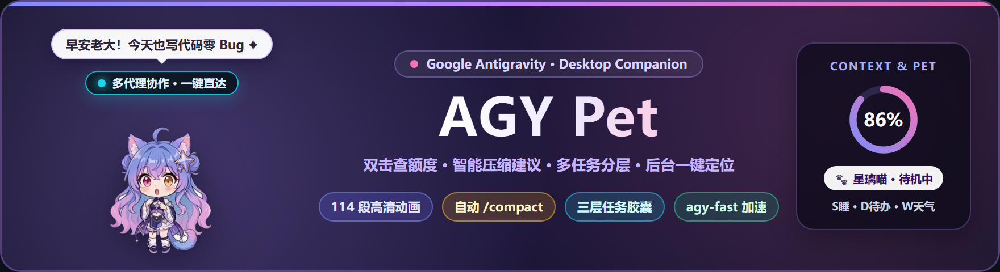
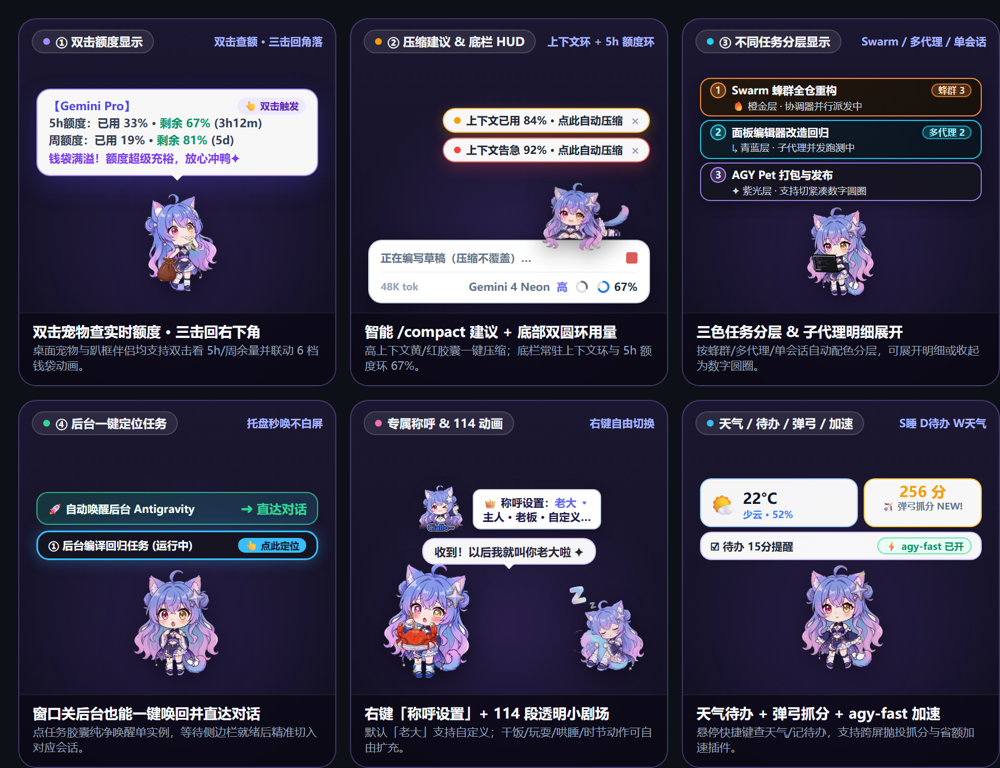

<div align="center">



# 🐾✨ AGY Pet (`agy-pet`)

**Google Antigravity 向けの透明デスクトップペット、入力欄コンパニオン、階層化タスクカプセル、下部デュアルリング HUD、Studio UI ＆ `agy-fast` 高速化スイート**

Antigravity 内蔵の **Chrome DevTools Protocol（CDP）** による非破壊・動的インジェクションを採用。**本体ファイルは一切改変せず**、デフォルトの「マネージド起動モード」では常駐プロセス **0** で動作し、いつでもワンクリックで完全に元に戻せます。

<p>
  <a href="#interactive-guide"></a>
  <a href="#interactive-guide"></a>
  <a href="#quick-start"></a>
  <a href="#key-features"></a>
  <a href="LICENSE"></a>
</p>

<p>
  🌐 <a href="README.md">简体中文</a> ·
  <a href="README.en.md">English</a> ·
  <strong>日本語</strong> ·
  <a href="README.ko.md">한국어</a> ·
  <a href="README.zh-TW.md">繁體中文</a>
</p>

[✨ 主な機能](#key-features) · [🎮 実機プレビュー・操作ガイド](#interactive-guide) · [🚀 クイックスタート](#quick-start) · [💌 出典・謝辞](#credits)

</div>

> [!NOTE]
> **出典・派生元の明記**：本プロジェクトは [0DNANCY/agy-claude-style](https://github.com/0DNANCY/agy-claude-style)（MIT License）をベースに拡張・再構築しています。デスクトップペットの操作体験と物理ギミックは [PC2005-cloud/dsh-pet](https://github.com/PC2005-cloud/dsh-pet) を参考にし、`agy-fast` プラグインは [INK-Q/agy-fast](https://github.com/INK-Q/agy-fast)（MIT License）を同梱しています。詳細は [出典・サードパーティ謝辞](#credits) をご覧ください。

---

<a id="key-features"></a>
## ✨ 主な機能

### 💰 1. ダブルクリックでクォータ確認 · トリプルクリックで右下へ帰還
- **デスクトップペット／入力欄コンパニオン共通のダブルクリック操作**：現在のモデルプールの **5 時間枠・週間枠の使用率／残量％とリセットまでの残り時間** を即座に表示し、使用率に応じた 6 段階の巾着アニメーションと連動します（睡眠中でも表示可能）。
- **デスクトップペットをトリプルクリック**（または右クリック →「右下へ戻る」）：即座に画面右下へ定位置復帰。ダブルクリック長押しでのスリングショット発射とも競合しません。

### 🗜️ 2. スマート自動圧縮提案（高コンテキスト時のワンクリック `/compact`）
- 会話コンテキスト使用率を常時監視し、**80% 以上（黄色の注意）**・**90% 以上（赤色の警告）** で伴侶の上にパルス通知カプセルを表示。
- クリックするだけで **入力中の下書きを消さずに** ネイティブ経路で `/compact` を送信し、完了時に自動でお祝いします。

### 📊 3. 入力欄フッター常駐 HUD（コンテキストリング + 5h クォータ残量リング）
- モデル名・思考強度（例：`Gemini 4 Neon 高`）の横にリアルタイム使用量 HUD を統合：
  - **インライン統計**：ターン／ステップ数、生成速度（`tok/s`）、総トークン数、キャッシュヒット率を表示（狭幅時は段階的に自動折りたたみ）。
  - **コンテキスト占有リングアイコン**：使用率を円環アイコンで表示し、残量 **20% 以下で琥珀色**・**10% 以下で赤枠警告** に変化。ホバーで詳細トークン数、クリックで **トークン内訳ポップオーバー** を開きます。
  - **5h クォータ残量リング＋％表示**：残量％（例：`67%`）を動的カラー（青 `#257de0` → 黄 `#fbb315` → 赤 `#dc3c3d`）で表示。クリックで **全モデルプール残量一覧** を表示します。

### 🧱 4. タスク階層カラー表示（Swarm / マルチエージェント / 単一セッション）
- ペット頭上のタスクカプセルを **🔥 橙金（Swarm）** / **💠 シアン（マルチエージェント・子タスク展開可）** / **✦ バイオレット（単一セッション）** の 3 階層で自動分類。フル表示とコンパクト数字バッジをワンクリック切替できます。

### 🚀 5. バックグラウンドからのワンクリック即座復帰＆会話ジャンプ
- Antigravity をトレイへ格納・最小化している状態でも、ペット頭上のタスクカプセルをクリックするだけで **白画面フリーズを起こさずクリーンにウィンドウを復帰し、対象会話へ直接ジャンプ** します。

### 🐾 6. 114 種の高解像度透明アニメーション・20 種の入力欄ポーズ・`agy-fast` 同梱
- DirectComposition + WebView2 による軽量透過描画。右クリックの **「呼び方設定」**（カスタム呼称対応）、バネ物理ドラッグ＆空中キャッチ採点、リアルタイム天気・頭上 ToDo（15 分前通知）、ホバーショートカット（`S`/`D`/`W`/`C`）、[INK-Q/agy-fast](https://github.com/INK-Q/agy-fast) ワンクリック切替を搭載。

---

<a id="interactive-guide"></a>
## 🎮 実機プレビュー・操作ガイド

<div align="center">
  
</div>

| 操作 | トリガー | 動作 |
| --- | --- | --- |
| 💰 **クォータ即確認** | デスクトップペットまたは入力欄伴侶をダブルクリック | 5h／週間残量％とリセット時刻＋6 段階巾着アニメを表示 |
| 🏠 **右下へ戻る** | デスクトップペットをトリプルクリック | 即座に画面右下の定位置へ移動 |
| 📊 **フッター詳細表示** | 入力欄下部のコンテキスト環または `XX%` クォータ環をクリック | トークン内訳または全モデルクォータ一覧を展開 |
| 🗜️ **ワンクリック圧縮** | コンテキスト ≥80%/90% 時の黄／赤カプセルをクリック | 下書きを保護したまま `/compact` を実行 |
| 🚀 **バックグラウンド復帰** | ペット頭上のタスクカプセルをクリック | トレイから Antigravity を復帰し該当会話へ直行 |
| ⌨️ **ホバーキー** | ペット上にカーソルを置いて `S` / `D` / `W` / `C` | `S` 睡眠 · `D` ToDo · `W` 天気 · `C` おしゃべり |

---

<a id="quick-start"></a>
## 🚀 クイックスタート

> [!TIP]
> 本 Git リポジトリはソースコードのみ（約 8.6 MB）です。114 種の WebM アニメーションをすべて同梱した **Node.js 不要** の Windows インストーラー `AGY-Pet-v2.0.0-Windows-x64.exe` は **[Releases](https://github.com/Mexix-Collab/agy-pet/releases)** からダウンロードしてください。

```bash
# macOS / Linux（Node.js >= 22）
git clone https://github.com/Mexix-Collab/agy-pet.git
cd agy-pet
npm run managed   # マネージド起動（推奨）
npm test          # 全 97 テストを実行
```

---

<a id="credits"></a>
## 💌 出典・サードパーティ謝辞

- **[0DNANCY/agy-claude-style](https://github.com/0DNANCY/agy-claude-style)**（MIT）：ベースプロジェクト（CDP 注入・二重起動モード・5 言語 i18n・Token HUD・ビルド基盤）。
- **[Nwflower/dsh-claude-style](https://github.com/Nwflower/dsh-claude-style)** / **[Microqian2th/dsh-codex-effort-slider](https://github.com/Microqian2th/dsh-codex-effort-slider)** / **[mobius/dsh-performance-slider](https://github.com/mobius/dsh-performance-slider)**：Studio UI および思考スライダーの着想元。
- **[PC2005-cloud/dsh-pet](https://github.com/PC2005-cloud/dsh-pet)**：デスクトップペットのインタラクション・物理演出の参考元（Windows 実装は C# WinForms + DirectComposition + WebView2 にて独自構築）。
- **[INK-Q/agy-fast](https://github.com/INK-Q/agy-fast)**（MIT）：`plugins/agy-fast/` にオリジナルライセンスを保持して同梱。
- **ランタイム・API**：Microsoft Edge `WebView2Loader.dll`、[Open-Meteo](https://open-meteo.com/)、`ip-api.com` / `ipwho.is`。商用フォントは一切含みません。

## 📜 ライセンス
[MIT License](LICENSE) の下で公開されています。
