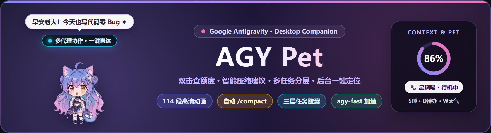
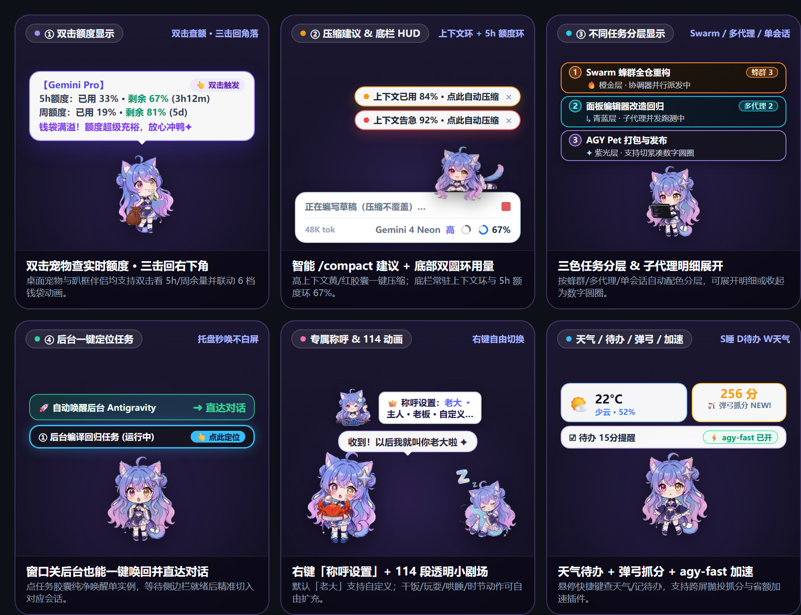

<div align="center">



# 🐾✨ AGY Pet (`agy-pet`)

**Google Antigravity를 위한 투명 데스크톱 펫, 입력창 컴패니언, 계층형 작업 캡슐, 하단 듀얼 링 사용량 HUD, Studio UI 및 `agy-fast` 가속 스위트**

Antigravity 내장 **Chrome DevTools Protocol(CDP)** 기반 무손실 동적 주입 방식으로 **원본 설치 파일을 전혀 수정하지 않으며**, 기본 「관리형 실행 모드」에서는 평소 백그라운드 프로세스 **0개**로 동작하고 언제든 원클릭으로 깔끔하게 복구할 수 있습니다.

<p>
  <a href="#interactive-guide"></a>
  <a href="#interactive-guide"></a>
  <a href="#quick-start"></a>
  <a href="#key-features"></a>
  <a href="LICENSE"></a>
</p>

<p>
  🌐 <a href="README.md">简体中文</a> ·
  <a href="README.en.md">English</a> ·
  <a href="README.ja.md">日本語</a> ·
  <strong>한국어</strong> ·
  <a href="README.zh-TW.md">繁體中文</a>
</p>

[✨ 핵심 기능](#key-features) · [🎮 실기 화면 및 조작 가이드](#interactive-guide) · [🚀 빠른 시작](#quick-start) · [💌 출처 및 감사](#credits)

</div>

> [!NOTE]
> **출처 및 2차 개발 명시**: 본 프로젝트는 [0DNANCY/agy-claude-style](https://github.com/0DNANCY/agy-claude-style)(MIT License)를 기반으로 확장 재구성되었으며, 데스크톱 펫 상호작용과 물리 연출은 [PC2005-cloud/dsh-pet](https://github.com/PC2005-cloud/dsh-pet)에서 영감을 받았습니다. 내장 `agy-fast` 플러그인은 [INK-Q/agy-fast](https://github.com/INK-Q/agy-fast)(MIT License) 출처입니다. 자세한 내용은 [출처 및 서드파티 감사](#credits)를 참조하세요.

---

<a id="key-features"></a>
## ✨ 핵심 기능

### 💰 1. 더블클릭 실시간 할당량 확인 · 트리플클릭 우측 하단 복귀
- **데스크톱 펫 / 입력창 컴패니언 모두 더블클릭으로 할당량 조회**: 현재 모델 풀의 **5시간 및 주간 할당량 사용률/잔여 %와 초기화 카운트다운**을 즉시 표시하며, 사용 구간별 6단계 복주머니 애니메이션과 연동됩니다(수면 중에도 정상 표시).
- **데스크톱 펫 트리플클릭**(또는 우클릭 → `화면 우측 하단으로 이동`): 즉시 우측 하단 기본 위치로 복귀하며, 더블클릭 드래그 새총 발사와 충돌하지 않습니다.

### 🗜️ 2. 스마트 컨텍스트 압축 제안 (자동 `/compact`)
- 현재 대화 컨텍스트 점유율이 **80% 이상(황색 경고)** 또는 **90% 이상(적색 긴급)**에 도달하면 컴패니언 위에 펄스 알림 캡슐이 자동 표시됩니다.
- 클릭 한 번으로 **입력창에 작성 중인 초안을 덮어쓰지 않고** 네이티브 채널로 `/compact`를 즉시 전송합니다.

### 📊 3. 입력창 하단 실시간 사용량 HUD (컨텍스트 점유 링 아이콘 + 5h 할당량 링)
- 입력창 하단 모델/사고 강도 표시(예: `Gemini 4 Neon 높음`) 옆에 실시간 사용량 HUD를 깔끔하게 통합했습니다:
  - **인라인 텔레메트리**: 턴/스텝 수, 생성 속도(`tok/s`), 총 토큰, 캐시 적중률을 표시하며 좁은 창에서는 단계적으로 자동 접힘.
  - **컨텍스트 점유 링 아이콘**: 현재 컨텍스트 사용 비율을 원형 아이콘으로 표시하고, 잔여 **20% 이하 황색 경고 · 10% 이하 적색 경고**로 자동 전환됩니다. 클릭 시 **토큰 상세 내역 팝오버**를 엽니다.
  - **실시간 5h 할당량 잔여 링 + %**: 현재 모델 풀의 5시간 잔여 할당량(예: `67%`)을 동적 색상(파랑 `#257de0` → 노랑 `#fbb315` → 빨강 `#dc3c3d`)으로 표시하며, 클릭 시 **전체 모델 할당량 현황**을 보여줍니다.

### 🧱 4. 작업 유형별 3계층 색상 표시 (Swarm / 멀티 에이전트 / 단일 세션)
- 펫 머리 위 작업 캡슐을 **🔥 오렌지 골드(Swarm)** · **💠 시안(멀티 에이전트, 서브태스크 펼치기 지원)** · **✦ 바이올렛(단일 세션)** 3계층으로 자동 분류하며, 전체 카드와 컴팩트 숫자 배지를 원클릭 전환할 수 있습니다.

### 🚀 5. 백그라운드 원클릭 작업 복귀 (트레이 즉시 깨우기 · 백화 방지)
- Antigravity 창이 최소화되었거나 트레이에 숨겨진 상태에서도 펫 위 작업 캡슐을 클릭하면 **빈 흰 화면 멈춤 없이 창을 깔끔하게 깨우고 해당 대화로 정확히 이동**합니다.

### 🐾 6. 114종 고화질 투명 애니메이션 · 20종 입력창 포즈 · `agy-fast` 내장
- Windows DirectComposition + WebView2 하드웨어 합성, 우클릭 **호칭 설정**(기본/8종 프리셋/사용자 지정), 스프링 드래그 & 공중 캐치 점수판, 실시간 날씨/할 일 알림(15분 전), 호버 단축키(`S`/`D`/`W`/`C`), [INK-Q/agy-fast](https://github.com/INK-Q/agy-fast) 원클릭 통합을 지원합니다.

---

<a id="interactive-guide"></a>
## 🎮 실기 화면 및 조작 가이드

<div align="center">
  
</div>

| 기능 | 조작 방법 | 동작 설명 |
| --- | --- | --- |
| 💰 **실시간 할당량 조회** | 데스크톱 펫 또는 입력창 컴패니언 더블클릭 | 5h/주간 잔여 % 및 초기화 시간 표시 + 6단계 복주머니 모션 |
| 🏠 **우측 하단 복귀** | 데스크톱 펫 빠르게 3번 클릭(트리플클릭) | 즉시 화면 우측 하단 정위치로 복귀 |
| 📊 **하단 듀얼 링 상세** | 입력창 하단 컨텍스트 링 또는 `XX%` 할당량 링 클릭 | 토큰 구성 내역 / 전체 모델 할당량 팝오버 표시 |
| 🗜️ **원클릭 `/compact`** | 컨텍스트 ≥80%/90% 시 황/적 펄스 캡슐 클릭 | 입력 중 초안을 유지한 채 `/compact` 즉시 전송 |
| 🚀 **백그라운드 작업 이동** | 펫 위 계층형 작업 캡슐 클릭 | 트레이에서 Antigravity를 깨우고 대상 대화로 직행 |
| ⌨️ **호버 단축키** | 펫 위 마우스 호버 후 `S` / `D` / `W` / `C` | `S` 수면 · `D` 할 일 · `W` 날씨 · `C` 말풍선 |

---

<a id="quick-start"></a>
## 🚀 빠른 시작

> [!TIP]
> 본 Git 저장소는 순수 소스 코드만 포함(약 8.6 MB)합니다. 114종 WebM 애니메이션이 모두 내장되고 **Node.js가 필요 없는** Windows 설치 파일 `AGY-Pet-v2.0.0-Windows-x64.exe`는 **[Releases](https://github.com/Mexix-Collab/agy-pet/releases)**에서 바로 다운로드하세요.

```bash
# macOS / Linux (Node.js >= 22)
git clone https://github.com/Mexix-Collab/agy-pet.git
cd agy-pet
npm run managed   # 관리형 실행 (권장)
npm test          # 전체 97개 테스트 실행
```

---

<a id="credits"></a>
## 💌 출처 및 서드파티 감사

- **[0DNANCY/agy-claude-style](https://github.com/0DNANCY/agy-claude-style)** (MIT): CDP 주입, 관리/상주 이중 모드, 5개 언어 i18n, Token HUD 및 빌드 프레임워크 원본 기반.
- **[Nwflower/dsh-claude-style](https://github.com/Nwflower/dsh-claude-style)** / **[Microqian2th/dsh-codex-effort-slider](https://github.com/Microqian2th/dsh-codex-effort-slider)** / **[mobius/dsh-performance-slider](https://github.com/mobius/dsh-performance-slider)**: Studio UI 및 사고 강도 슬라이더 영감.
- **[PC2005-cloud/dsh-pet](https://github.com/PC2005-cloud/dsh-pet)**: 데스크톱 펫 상호작용 및 물리 기믹 참고(Windows 호스트는 C# WinForms + DirectComposition + WebView2로 독자 구현).
- **[INK-Q/agy-fast](https://github.com/INK-Q/agy-fast)** (MIT): 원본 라이선스를 유지하여 `plugins/agy-fast/`에 내장.
- **런타임 & 오픈 API**: Microsoft Edge `WebView2Loader.dll`, [Open-Meteo](https://open-meteo.com/), `ip-api.com` / `ipwho.is`. 상업용 폰트 미포함(시스템 기본 폰트 스택 사용).

## 📜 라이선스
[MIT License](LICENSE)에 따라 배포됩니다.
