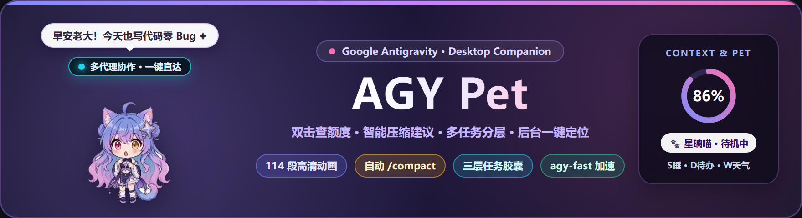
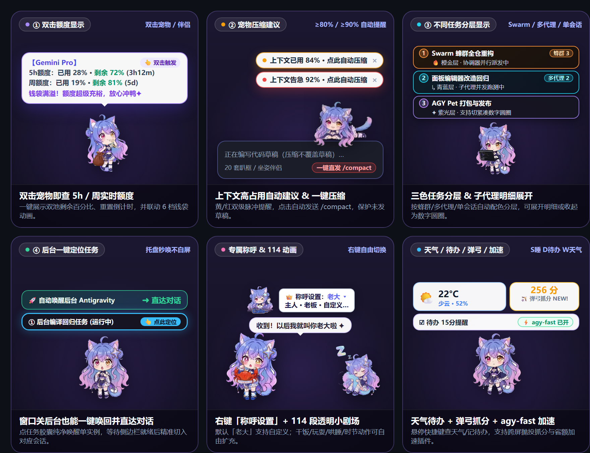

<div align="center">



# 🐾✨ AGY Pet (`agy-pet`)

**专为 Google Antigravity 打造的透明桌面宠物、输入框趴框伴侣、实时任务胶囊、界面重塑与 `agy-fast` 加速套件**

基于 Antigravity 内置 **Chrome DevTools Protocol（CDP）** 调试端口实现无损动态注入——**不修改任何原版安装文件**，默认「托管启动」平时 **0 进程后台常驻**，随时可一键无痕卸载还原。

<p>
  <a href="#宠物互动指南"></a>
  <a href="#宠物互动指南"></a>
  <a href="#快速开始"></a>
  <a href="#核心特性"></a>
  <a href="LICENSE"></a>
</p>

[✨ 核心特性](#核心特性) · [🎮 宠物互动指南](#宠物互动指南) · [🚀 快速开始](#快速开始) · [⚙️ 配置与自定义](#配置说明) · [🗂️ 项目结构](#项目结构) · [💌 来源声明](#来源声明)

</div>

> [!NOTE]
> **二次开发与来源声明**：本项目基于 [0DNANCY/agy-claude-style](https://github.com/0DNANCY/agy-claude-style)（MIT License）扩展重构而来；桌面宠物交互理念与物理玩法灵感参考 [PC2005-cloud/dsh-pet](https://github.com/PC2005-cloud/dsh-pet)；内置集成的 `agy-fast` 加速插件来源于 [INK-Q/agy-fast](https://github.com/INK-Q/agy-fast)（MIT License）。完整上游项目与第三方组件清单请见 [来源声明与第三方致谢](#来源声明)。

---

<a id="目录"></a>
## 🗺️ 目录

- [✨ 核心特性](#核心特性)
- [🎮 宠物互动与饲养指南](#宠物互动指南)
- [🚀 快速开始（下载与运行模式）](#快速开始)
- [⚙️ 配置说明与自定义动画](#配置说明)
- [🗂️ 项目结构](#项目结构)
- [🧪 开发、测试与构建](#开发测试与构建)
- [💌 来源声明与第三方致谢](#来源声明)
- [📜 开源协议](#开源协议)

---

<a id="核心特性"></a>
## ✨ 核心特性

### 💰 1. 双击额度显示（5h / 周双池实时余量 + 钱袋动效）
- **双击输入框伴侣或右键桌面宠物「看看额度用量」**：立即弹出当前模型池的 **5h 额度与周额度已用/剩余百分比及重置倒计时**，并按已用区间（0%–100%）自动联动 6 档专属钱袋动画（钱袋满溢 → 金袋叮当 → 钱袋如常 → 数金皱眉 → 袋空如洗 → 分文不剩）。

### 🗜️ 2. 宠物智能压缩建议（高上下文自动 `/compact`）
- 实时监测当前对话上下文占用率：达到 **≥80%（黄色预警）** 或 **≥90%（红色告急）** 时，伴侣上方自动弹出脉冲提醒胶囊（`上下文已用 XX% · 点此自动压缩`）。
- 点击胶囊即可直接向当前对话发送 `/compact` 自动整理上下文——**优先走原生提交通道，不覆盖你在输入框里还没发出的草稿文本**，压缩完成后自动欢呼复位。

### 🧱 3. 任务状态不同任务分层显示（Swarm / 多代理 / 单会话）
- 宠物头顶实时呈现多会话任务进度胶囊栈，并按任务类型自动分层配色与标识：
  - **🔥 橙金层（Swarm 蜂群协作）**：显示蜂群规模徽章与协调器实时进展；
  - **💠 青蓝层（多子代理并发）**：显示运行中子代理数量，点击可展开查看子代理/子任务明细；
  - **✦ 紫光层（普通单会话）**：展示当前工具/步骤耗时，并在完成/等待拍板/出错时自动切换绿/黄/红状态色。
- 支持一键在 **「完整进度条」** 与 **「紧凑数字圆圈」** 之间切换，桌面零遮挡。

### 🚀 4. 后台快速一键定位任务（托盘秒唤不白屏）
- 即使 Antigravity 窗口已最小化或关闭至系统托盘后台运行，只要桌面宠物头顶有活动任务胶囊，**单击对应任务胶囊即可自动干净唤醒 Antigravity 主窗口，并在首屏与侧边栏就绪后精准跳转至目标对话**，告别冷启动卡白屏或手动翻找会话。

### 🐾 5. Windows 透明桌面宠物（114 段动画）& 20 套趴框伴侣 & `agy-fast` 加速
- **114 段高清透明 WebM 桌面宠物**：基于 DirectComposition + WebView2 硬件合成，支持右键 **「👑 称呼设置」**（默认 **「老大」**，内置 8 种预设与自定义称呼）、弹簧拖拽、双击弹弓发射与空中抓取积分、实时天气卡片、头顶待办（到期前 15 分钟提醒）、悬停快捷键（`S`/`D`/`W`/`C`）以及右键打开目录放入自定义 `.webm`。
- **20 套输入框趴框/坐姿猫娘动画**（10 趴框 + 10 坐姿）：随打字/思考/编码/庆祝/打盹自动切换，并保留经典像素小螃蟹可选。
- **Studio 界面重塑、Token HUD、5 语言本地化 & `agy-fast` 一键集成**：涵盖黑曜石蓝/Claude 配色、字符波纹场、用量热力图、3 风格思考滑块、5 语言（含 Swarm 侧栏），安装器与宠物右键均可一键启停 [INK-Q/agy-fast](https://github.com/INK-Q/agy-fast) 减少轮次省额度。

---

<a id="宠物互动指南"></a>
## 🎮 实机效果与宠物互动指南

<div align="center">
  
</div>

### 🕹️ 桌面宠物互动操作一览

| 互动方式 | 触发方法 | 效果说明 |
| --- | --- | --- |
| 💰 **双击查实时额度** | 双击输入框伴侣（或右键桌面宠物 `💰 看看额度用量`） | 弹出 5h/周额度剩余百分比与重置倒计时，并联动 6 档钱袋动效 |
| 🗜️ **一键压缩上下文** | 上下文 ≥80%/90% 时点击伴侣上方黄/红脉冲胶囊 | 无损直发 `/compact` 压缩当前会话，不覆盖未发草稿 |
| 🚀 **后台一键定位任务** | 点击桌面宠物头顶任意分层任务胶囊（蜂群/多代理/单会话） | 后台托盘秒速唤醒 Antigravity 并精准切换至目标对话 |
| 👆 **戳戳 / 挠痒痒** | 单击或快速连点宠物身体 | 触发 5 种点击回应表情；连点触发「挠痒咯咯笑」 |
| 🤏 **弹簧拖拽 & 弹弓抓分** | 左键拖拽甩出，或双击按住向下拉弓松手 | 跨屏弹性抛投；空中高速点击抓住触发粒子爆发与积分榜 |
| 👑 **自定义对你的称呼** | 右键 → `👑 称呼设置` | 默认「老大」，支持 8 种预设或自定义称呼，立即同步全部文案 |
| ⌨️ **悬停快捷键** | 鼠标悬停宠物时按 `S` / `D` / `W` / `C` | `S` 哄睡/叫醒 · `D` 头顶待办 · `W` 实时天气 · `C` 随机碎碎念 |

<details>
<summary>🎬 <b>点此展开：查看完整动作档案（桌面宠物 114 段 + 输入框伴侣 20 套）</b></summary>

- **桌面宠物 114 段高清透明 WebM（随 Release 安装包分发）**：
  - **点击回应（5）**：开心跃动、元气挥手、害羞惊讶、傲娇生气、挠痒咯咯笑
  - **走路与漫游（6）**：侧身急躁跑、开心小跑、螃蟹走路、原地左转奔跑、原地漂浮踏步、东张西望
  - **工作状态联动（7）**：思考冒泡、忙碌点按、清点归档、原地踱步张望、雀跃庆祝、垂头叹气冒汗、写代码
  - **睡觉与碎碎念（8）**：睡觉-开始/循环/起来、擦桌/发呆/对屏碎碎念、是啊吃什么、深度思考碎碎念
  - **额度钱袋（6）**：钱袋满溢、金袋叮当、钱袋如常、数金皱眉、袋空如洗、分文不剩
  - **日常小动作（18）**：待机呼吸休闲、悠闲哼歌、超大伸懒腰、敲击桌面、重力下蹲、哈欠连天、小憩沉眠、女仆屈膝、被吓一跳、360度旋转、偷吃被抓、鲸尾拍地、打瞌睡惊醒、照镜子、换装试色、轻快记录、摇扇纳凉、晨间刷牙
  - **玩耍与才艺（27）**：玩魔方、玩具汽车、鲸鱼吐泡、跳抓头顶、玩游戏气急、玩水枪、小提琴、蓝鲸现世、优雅女仆舞、摇摆舞、可爱宅舞、吹气球、动物环绕、放风筝、拆礼物、变鸽子、扑克魔术、抽陀螺、吹笛子、头顶开花、撸猫、凭空生花、骑木马、三球抛接、踢毽子、下五子棋、荡秋千
  - **干饭与零食（15）**：吃白饭、碗饭、饭团、期待开饭、早/午/晚餐、大口零食、吃Token、冰淇淋融化、大闸蟹、糖葫芦、长寿面、吃西瓜、涮火锅
  - **时节与节日（21）** + **拖拽悬空（1）**：落叶、赏月吃月饼、堆雪人、放烟花、粽子、年糕、青团、腊八粥、重阳糕、收红包、写福字、乞巧、舞狮、南瓜灯、赏菊、放河灯、小幽灵、圣诞树、孔明灯、汤圆、饺子、拖拽悬空
- **输入框伴侣 20 套内嵌动画**：
  - **趴框 10 套**：待机呼吸、盯打字、深度思考、敲代码、枕臂打盹、犯困哈欠、晃小脚、害羞飞机耳、拨弄蓝星、拍框卖萌
  - **坐姿 10 套**：乖巧待机、比耶庆祝、远眺守候、喝奶茶、吃团子、翻本本、听音乐、傲娇鼓嘴、伸懒腰、元气挥手

</details>

---

<a id="快速开始"></a>
## 🚀 快速开始

> [!TIP]
> **开箱即用（强烈推荐）**：本 Git 代码仓库保持极致轻量（约 8.6 MB，**仅包含源码，不包含 114 段大体积桌面宠物 `.webm` 动画文件**）。请直接前往 **[Releases](https://github.com/Mexix-Collab/agy-pet/releases)** 下载内置全套动画的独立安装器 `AGY-Pet-v<version>-Windows-x64.exe`，目标机器无需安装 Node.js！

### 🔄 运行模式对比

| 对比维度 | 🐾 托管启动模式（免后台常驻 · **推荐默认**） | 🛰️ 常驻守护模式（开机自启 · 兼容原习惯） |
| --- | --- | --- |
| **开机自启** | ❌ 不注册开机自启 | ✅ 注册开机自启（Windows Startup / macOS `LaunchAgent`） |
| **平时后台占用** | **0 进程常驻**（Antigravity 关闭后自动退出） | 1 个轻量原生守护进程持续监听 |
| **启动入口** | 桌面 / 开始菜单「`Antigravity (AGY Pet)`」快捷方式 | 直接点击系统原版 Antigravity 图标 |
| **CDP 接管** | 自动附加 `--remote-debugging-port=0` 启动或温和重启 | 后台检测到未开 CDP 的实例自动温和重启接管（可关闭） |

### 🪟 方式一：Windows 独立安装器（目标机器无需 Node.js）

1. 前往 **[Releases](https://github.com/Mexix-Collab/agy-pet/releases)** 下载 `AGY-Pet-v2.0.0-Windows-x64.exe`。
2. 双击运行，在全新高 DPI 安装器界面选择运行模式（默认「免后台常驻」）及是否同时启用 `agy-fast` 加速插件，点击 **「开始安装」**：
   - 资源部署至 `%LOCALAPPDATA%\agy-pet`（如本机曾安装过旧版 `agy-claude-style`，会自动停旧、平滑迁移 `config.json` / `desktop-pet.json` / `pet-todos.json` 并清理旧快捷方式）。
   - 安装器支持随时重新运行以无损切换模式、升级或一键「卸载并恢复」原生界面。
3. 命令行静默参数：
   ```text
   AGY-Pet-v2.0.0-Windows-x64.exe [--silent | /S | -s] [--uninstall] [--status]
                                  [--mode=managed | --mode=daemon | --managed | --daemon]
                                  [--desktop-shortcut | --no-desktop-shortcut]
                                  [--agy-fast | --no-agy-fast]
                                  [--no-autostart] [--no-kill-legacy]
                                  [--install-dir <路径>] [--cdp-port <端口>]
                                  [--out <结果JSON路径>] [--popup]
   ```

### 🍎 方式二：macOS / Linux（Node.js >= 22 或源码构建）

```bash
git clone https://github.com/Mexix-Collab/agy-pet.git
cd agy-pet

# 跨平台托管启动（带 CDP 启动 Antigravity 并在宿主关闭后自动退出）
npm run managed

# 单次注入 / 常驻监听 / 无损卸载还原
npm run inject
npm run watch
npm run remove

# 在 macOS 上编译 Universal .app 与 .dmg（需 Xcode Command Line Tools）
npm run build:macos
```

> [!IMPORTANT]
> **Antigravity 2.33.0+ 说明**：Antigravity 需携带 `--remote-debugging-port=0` 启动参数才能开启本地 CDP 端口。使用安装器生成的「`Antigravity (AGY Pet)`」快捷方式或 `npm run managed` 会自动处理，无需手动配置。

---

<a id="配置说明"></a>
## ⚙️ 配置说明与自定义动画

* **界面主题 / HUD / 语言设置**：打开 Antigravity `设置 → 外观`，底部自动集成可视化开关并实时原子写入 `config.json`（也可参考 [config.example.json](config.example.json) 与 [cdp.js](cdp.js) 中的 `DEFAULT_CONFIG`）。
* **桌面宠物偏好**：全部持久化在 `%LOCALAPPDATA%\agy-pet\desktop-pet.json`（含宠物大小、昵称、称呼 `userTitle`、气泡字体、物理抛投参数、天气城市、空中抓取最高分等），头顶待办存储在 `pet-todos.json`。
* **自制透明 WebM 动画**：可使用 [neko-studio/clean_greenscreen_webm.py](neko-studio/clean_greenscreen_webm.py) 对纯绿幕 (`#00FF00`) 视频进行物理级反混合抠像与透明通道压制，将成品 `.webm` 放入 `%LOCALAPPDATA%\agy-pet\anims\webm\`（或源码构建前放入 `neko-studio/webm-opt/`）即可使用；提示词参考见 [neko-studio/动作生成提示词.md](neko-studio/动作生成提示词.md)。

---

<a id="项目结构"></a>
## 🗂️ 项目结构

```text
agy-pet/
├── .github/workflows/                 # CI 跨平台测试与手动发布工作流
├── assets/                            # README 原创 SVG 视觉头图与玩法卡片
├── cdp.js / inject.js / remove.js     # Node 端 CDP 注入、热更新监听与 Fail-Closed PID 校验
├── style.css / ui-runtime.js          # Studio 界面、20 套趴框猫娘、Token HUD 与设置面板集成
├── i18n-core.js / i18n-locales.js     # 5 语言 DOM 翻译引擎与词典（含 Plan/Orchestrator/Swarm）
├── sidecar-core.js                    # Swarm 蜂群侧栏精简翻译运行时
├── usage-core.js / effort-core.js     # 会话遥测解析、热力图与 3 风格思考滑块
├── mascot-core.js / ripple-core.js    # 伴侣状态机与首页字符波纹场
├── crab-assets.js / perf-assets.js    # 内嵌 20 套趴框/坐姿伴侣、贴图、像素螃蟹与滑块背景帧
├── installer/
│   ├── common/
│   │   ├── AgyFastHelper.cs           # agy-fast 加速插件一键部署、启停与卸载模块
│   │   ├── CdpClient.cs               # C# 轻量 CDP 客户端、纯净单实例唤醒与配置热更新
│   │   └── MiniJson.cs                # 零依赖 JSON 解析与序列化
│   ├── setup/Program.cs               # Windows 高 DPI 现代安装器 GUI/CLI 与旧版平滑迁移
│   ├── watcher/
│   │   ├── Program.cs                 # Windows 无窗 CDP 托管启动器与后台守护
│   │   ├── DesktopNeko.cs             # DirectComposition + WebView2 透明桌面宠物宿主与物理引擎
│   │   ├── pet-ui.html                # 桌面宠物前端（114 段动画机、任务胶囊栈、天气/待办/弹弓）
│   │   ├── WebView2Loader.dll         # Microsoft Edge WebView2 运行时加载器
│   │   └── assets/click-duck.wav      # Q 弹点击反馈音效
│   └── macos/                         # macOS Swift 原生安装器与守护进程
├── plugins/agy-fast/                  # 内置 agy-fast 加速插件（来源 INK-Q/agy-fast，MIT）
├── neko-studio/                       # 绿幕抠像脚本与提示词指南（114 段 .webm 随 Release 分发）
├── scripts/                           # 零依赖 Windows (.exe) 与 macOS (.app/.dmg) 构建脚本
└── test/                              # node:test 单元与端到端测试套件（96 项）
```

---

<a id="开发测试与构建"></a>
## 🧪 开发、测试与构建

```bash
# 运行全部 96 项单元测试与当前平台的安装器端到端测试（Node.js >= 22，零第三方 npm 依赖）
npm test

# 在 Windows 上编译独立安装器 AGY-Pet-v<version>-Windows-x64.exe（需系统自带 .NET Framework csc.exe）
# 若 neko-studio/webm-opt/ 存在 .webm 动画文件将自动打包进安装包
npm run build:installer

# 在 macOS 上编译 Universal .app 与 .dmg
npm run build:macos
```

---

<a id="来源声明"></a>
## 💌 来源声明与第三方致谢

本项目在设计与实现过程中基于或参考了以下开源项目、运行时组件与开放服务，特此明确列出并致谢 🌸：

### 1. 上游基础与衍生来源
- **上游基础项目（二次开发起点）**：[0DNANCY/agy-claude-style](https://github.com/0DNANCY/agy-claude-style)（MIT License）
  - 本项目在其 `v2.0.0` 基础上演进重构，承接 CDP 无损动态注入、托管/守护双模式架构、5 语言 i18n、Token HUD、设置面板集成及 Windows/macOS 原生构建框架。
- **Studio UI 风格与部分源码灵感**：[Nwflower/dsh-claude-style](https://github.com/Nwflower/dsh-claude-style)（承接自上游）
- **Codex 思考强度滑杆样式**：[Microqian2th/dsh-codex-effort-slider](https://github.com/Microqian2th/dsh-codex-effort-slider)（承接自上游）
- **梁武峰思考强度滑杆样式**：[mobius/dsh-performance-slider](https://github.com/mobius/dsh-performance-slider)（承接自上游）

### 2. 桌面宠物交互设计与内置插件
- **桌面宠物交互形态、动画分类与物理玩法灵感**：[PC2005-cloud/dsh-pet](https://github.com/PC2005-cloud/dsh-pet)
  - 参考其透明桌面宠物交互理念、动作分类组织、弹簧拖拽/双击弹弓抛投/空中抓取计分、牛奶白碎碎念气泡、实时天气与头顶待办清单及悬停快捷键设计；Windows 桌面宠物宿主与前端由本项目基于 C# WinForms + DirectComposition + WebView2 独立实现。
- **内置加速插件 `agy-fast`**：[INK-Q/agy-fast](https://github.com/INK-Q/agy-fast)（MIT License，作者 `inkwhite`）
  - 位于 `plugins/agy-fast/`，完整保留其原始 [LICENSE](plugins/agy-fast/LICENSE) 与元信息，提供可选一键部署/启停集成。

### 3. 第三方运行时组件与开放 API
- **Microsoft Edge WebView2 Loader (`WebView2Loader.dll`)**：Microsoft Edge WebView2 SDK 可再分发加载器，用于 Windows DirectComposition 透明渲染。
- **Open-Meteo API**（[open-meteo.com](https://open-meteo.com/)）：用于桌面宠物实时天气查询与城市地理编码（非商业免费开放接口）。
- **ip-api.com** / **ipwho.is**：未手动指定城市时的可选出口 IP 粗略定位回退接口（用户可随时在右键自定义城市名）。

### 4. 素材与字体合规说明
- **动画素材**：114 段桌面宠物透明 WebM 动画及 20 套输入框趴框/坐姿猫娘动画均为 AI 生成并通过 [neko-studio/clean_greenscreen_webm.py](neko-studio/clean_greenscreen_webm.py) 绿幕反混合抠像二次加工制作。
- **气泡字体**：本仓库不包含任何商业版权字体，全部采用零版权风险系统字体栈（幼圆 / 微软雅黑 / 楷体 / 漫画体）。

---

<a id="开源协议"></a>
## 📜 开源协议

本项目基于 [MIT License](LICENSE) 开源，并完整保留上游项目与内置第三方组件的原始版权声明。
