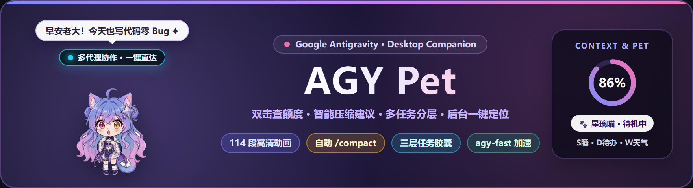
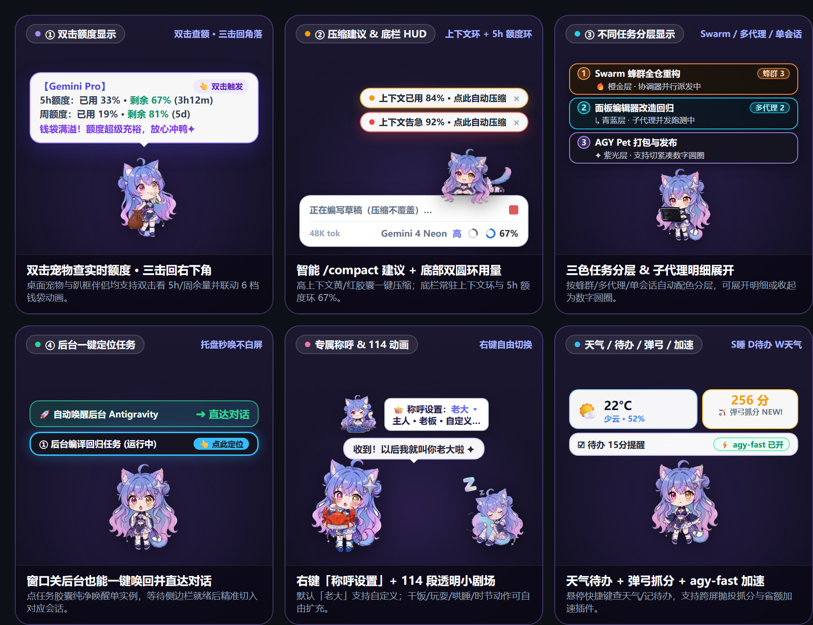

<div align="center">



# 🐾✨ AGY Pet (`agy-pet`)

**專為 Google Antigravity 打造的透明桌面寵物、輸入框趴框伴侶、分層任務膠囊、底部雙環用量 HUD、介面重塑與 `agy-fast` 加速套件**

基於 Antigravity 內建 **Chrome DevTools Protocol（CDP）** 除錯埠實現無損動態注入——**不修改任何原版安裝檔案**，預設「託管啟動」平時 **0 背景常駐行程**，隨時可一鍵無痕還原。

<p>
  <a href="#interactive-guide"></a>
  <a href="#interactive-guide"></a>
  <a href="#quick-start"></a>
  <a href="#key-features"></a>
  <a href="LICENSE"></a>
</p>

<p>
  🌐 <a href="README.md">简体中文</a> ·
  <a href="README.en.md">English</a> ·
  <a href="README.ja.md">日本語</a> ·
  <a href="README.ko.md">한국어</a> ·
  <strong>繁體中文</strong>
</p>

[✨ 核心特色](#key-features) · [🎮 實機效果與互動指南](#interactive-guide) · [🚀 快速開始](#quick-start) · [💌 來源聲明與致謝](#credits)

</div>

> [!NOTE]
> **二次開發與來源聲明**：本專案基於 [0DNANCY/agy-claude-style](https://github.com/0DNANCY/agy-claude-style)（MIT License）擴充重構；桌面寵物互動理念與物理玩法靈感參考 [PC2005-cloud/dsh-pet](https://github.com/PC2005-cloud/dsh-pet)；內建 `agy-fast` 加速外掛來源於 [INK-Q/agy-fast](https://github.com/INK-Q/agy-fast)（MIT License）。完整清單請見 [來源聲明與第三方致謝](#credits)。

---

<a id="key-features"></a>
## ✨ 核心特色

### 💰 1. 雙擊額度顯示 · 三擊回右下角（5h / 週雙池餘量 + 錢袋動效）
- **桌面寵物與輸入框伴侶統一支援雙擊查詢額度**：立即彈出目前模型池的 **5h 額度與週額度已用/剩餘百分比及重置倒數**，並依區間自動連動 6 檔專屬錢袋動畫（打盹睡眠時雙擊同樣照常顯示）。
- **快速三擊桌面寵物**（或右鍵 `🏠 回到螢幕右下角`）：零延遲歸位至螢幕最右下角，並完美相容「雙擊按住下拉」彈弓發射不衝突。

### 🗜️ 2. 寵物智慧壓縮建議（高上下文自動 `/compact`）
- 即時監測對話上下文佔用率，達 **≥80%（黃色預警）** 或 **≥90%（紅色告急）** 時於伴侶上方自動彈出脈衝提醒膠囊。
- 點擊即可透過原生通道直發 `/compact` 整理上下文——**不會覆蓋輸入框內尚未送出的草稿文字**。

### 📊 3. 輸入框底部即時用量 HUD（上下文佔用圓環圖示 + 5h 額度剩餘圓環）
- 於輸入框底欄模型與思考強度（如 `Gemini 4 Neon 高`）旁無干擾整合即時用量元件：
  - **內嵌用量遙測**：顯示輪次/步驟、生成速度（`tok/s`）、總 Token 與快取命中率，窄視窗自動分級收合。
  - **上下文佔用圓環圖示**：獨立環形進度圖示呈現上下文已用比例，剩餘 **≤20% 亮起琥珀黃預警**、**≤10% 亮起紅框告急**；懸停顯示精確餘量，點擊展開 **Token 構成拆解浮層**。
  - **即時 5h 額度剩餘圓環 + 百分比**：並列顯示目前模型池 5h 剩餘額度圓環與百分比（如 `67%`），依餘量動態變色（充裕藍 `#257de0` → 偏低黃 `#fbb315` → 告急紅 `#dc3c3d`）；點擊展開 **全模型池配額總覽浮層**。

### 🧱 4. 不同任務分層顯示（Swarm / 多代理 / 單會話）
- 寵物頭頂依任務類型自動分為 **🔥 橙金層（Swarm 蜂群）**、**💠 青藍層（多子代理，可展開明細）**、**✦ 紫光層（單一會話）**，支援一鍵切換完整進度條與緊湊數字圓圈。

### 🚀 5. 背景快速一鍵定位任務（系統匣秒喚不白屏）
- 即使 Antigravity 已最小化或收至系統匣背景執行，點擊桌面寵物頭頂任務膠囊即可 **純淨喚醒視窗並精準切換至目標對話**，告別冷啟動白屏卡頓。

### 🐾 6. 114 段高清透明桌面寵物 & 20 套趴框伴侶 & `agy-fast` 加速
- DirectComposition + WebView2 透明硬體合成，支援右鍵 **「👑 稱呼設定」**（預設「老大」，內建 8 種預設與自訂）、彈簧拖曳與空中抓取積分、即時天氣、頭頂待辦（15 分鐘前提醒）、懸停快捷鍵（`S`/`D`/`W`/`C`）及 [INK-Q/agy-fast](https://github.com/INK-Q/agy-fast) 一鍵啟停。

---

<a id="interactive-guide"></a>
## 🎮 實機效果與互動指南

<div align="center">
  
</div>

| 互動方式 | 觸發方法 | 效果說明 |
| --- | --- | --- |
| 💰 **雙擊查即時額度** | 雙擊桌面寵物或輸入框伴侶 | 彈出 5h/週額度剩餘百分比與重置倒數，連動 6 檔錢袋動效 |
| 🏠 **三擊回到右下角** | 快速三擊桌面寵物身體 | 立即歸位至螢幕最右下角 |
| 📊 **底欄雙圓環查明細** | 點擊輸入框底部上下文圓環或 5h 額度圓環 `XX%` | 分別展開 Token 構成拆解與全模型池 5h/週配額總覽 |
| 🗜️ **一鍵壓縮上下文** | 上下文 ≥80%/90% 時點擊伴侶上方黃/紅脈衝膠囊 | 無損直發 `/compact`，不覆蓋未送出草稿 |
| 🚀 **背景一鍵定位任務** | 點擊桌面寵物頭頂任一分層任務膠囊 | 系統匣秒速喚醒 Antigravity 並直達目標對話 |
| ⌨️ **懸停快捷鍵** | 滑鼠懸停寵物時按 `S` / `D` / `W` / `C` | `S` 哄睡/叫醒 · `D` 頭頂待辦 · `W` 即時天氣 · `C` 碎碎念 |

---

<a id="quick-start"></a>
## 🚀 快速開始

> [!TIP]
> 本 Git 儲存庫僅含輕量原始碼（約 8.6 MB）。請前往 **[Releases](https://github.com/Mexix-Collab/agy-pet/releases)** 直接下載內建 114 段透明動畫、**無需安裝 Node.js** 的 Windows 獨立安裝程式 `AGY-Pet-v2.0.0-Windows-x64.exe`。

```bash
# macOS / Linux（Node.js >= 22）
git clone https://github.com/Mexix-Collab/agy-pet.git
cd agy-pet
npm run managed   # 託管啟動（推薦）
npm test          # 執行全部 97 項測試
```

---

<a id="credits"></a>
## 💌 來源聲明與第三方致謝

- **[0DNANCY/agy-claude-style](https://github.com/0DNANCY/agy-claude-style)**（MIT）：上游基礎專案（CDP 無損注入、託管/守護雙模式、5 語言 i18n、Token HUD 與建置框架）。
- **[Nwflower/dsh-claude-style](https://github.com/Nwflower/dsh-claude-style)** / **[Microqian2th/dsh-codex-effort-slider](https://github.com/Microqian2th/dsh-codex-effort-slider)** / **[mobius/dsh-performance-slider](https://github.com/mobius/dsh-performance-slider)**：Studio UI 與思考強度滑桿靈感來源。
- **[PC2005-cloud/dsh-pet](https://github.com/PC2005-cloud/dsh-pet)**：桌面寵物互動形態與物理玩法參考來源（Windows 宿主以 C# WinForms + DirectComposition + WebView2 獨立實作）。
- **[INK-Q/agy-fast](https://github.com/INK-Q/agy-fast)**（MIT）：完整保留原始授權並內建於 `plugins/agy-fast/`。
- **執行期與開放 API**：Microsoft Edge `WebView2Loader.dll`、[Open-Meteo](https://open-meteo.com/)、`ip-api.com` / `ipwho.is`。不含任何商業版權字體。

## 📜 開源協議
本專案採用 [MIT License](LICENSE) 開源，並保留上游專案與內建元件的原始版權聲明。
